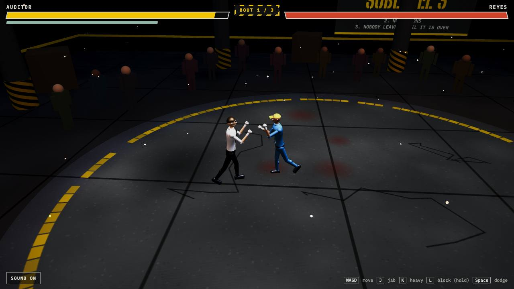

# Sublevel Three

Browser fighting game. One HTML file, no account, no build step to play.

**Play:** https://carlok.github.io/red-ink/

## About

You audit pallet counts on the night shift at Halvorsen Freight. The totals always reconcile. Tonight Pike hands you a keycard and points at a door that is not on the floor plan.

Three bouts, on a taped circle in a warehouse. Reyes teaches, Dag punishes a miss, Pike repeats your last three punches. Keyboard, standard gamepad, and touch. Drop a `.glb` on the title card to fight as an imported avatar. The engine is a tree-shaken Babylon.js build. The game runs from the files on disk. Google Fonts load when you are online and fall back to system fonts when you are not.

## Topics

`fighting-game` `babylonjs` `webgl` `browser-game` `html5` `gamepad` `touch` `apache-2.0`

## Run locally

Open `index.html` in Chrome, Firefox, or Edge.

License: Apache-2.0 (`LICENSE`, `NOTICE`). The sounds are CC0 (`audio/CC0.txt`).

## Quality assurance

- `npm run regression` — headless Chrome checks (bouts 1–6, hub/dock, input, offline `file://`).
- `npm run balance` — seeded bot win rates for all six foes.
- `npm run offline-zip` — writes `dist/sublevel-three-offline.zip` for offline play.
- `npm run qa:a11y` — axe on the title card (+ Lighthouse when the host finishes in time).
- Viewports: `docs/DEVICE-MATRIX.md`.

Engine: `lib/babylon.js` is a tree-shaken build of `@babylonjs/core` 9.30.0 plus the glTF 2.0 loader. License text: `lib/babylon.Apache-2.0.txt`. Regenerate the bundle with `npm install && npm run build:engine`.

## Controls

| | |
| --- | --- |
| Move | W A S D or arrow keys |
| Jab | J, also Z |
| Heavy | K, also X |
| Block (hold) | L, also C or Shift |
| Dodge | Space, also V |
| Pause | Esc, or Start on a pad |

On the title card, click Jab, Heavy, Block, or Dodge and press a new key. Movement stays on WASD. The Z, X, C, V, and Shift aliases stay.

Gamepad, standard mapping: left stick or d-pad moves, X jabs, Y is heavy, A dodges. LT and RT block once the trigger is past halfway. LB, RB, and B block as buttons.

The title card has Easy, Normal, and Hard. Normal uses the bout table as tuned. Easy and Hard scale that table: health, speed, damage, guard rate, and reaction. The same card has a rumble slider. 0 is off. Key bindings, difficulty, rumble, the Hits and Music sliders, mute, and Less motion are saved in local storage when the browser allows it.

Reyes shows a mark before a jab. Dag answers a miss with a marked heavy. Pike repeats your last three attacks. The card after a bout lists hits, blocks, dodges, and seconds in the corner.

A hit turns the head toward that side. Knockdowns fall back, crumple, or drop sideways. Bruises and sweat build during the bout.

The overhead light is cold. The hanging bulbs are sodium orange. The crowd around the ring is built from shoulders, arms, and legs, and they sway while they stand.

Hits, blocks, and the K.O. are samples. A room tone and three music loops sit under them, and the music ducks when a hit lands.

Esc pauses a bout. The first fight shows a 12-second control strip.

Touch: move stick on the left, Jab in the bottom-right of the button cluster. The view does not scroll or zoom.

Drop a `.glb` on the title screen to replace the auditor. Fighters are otherwise built in code (`makeFighter`). Tuning constants are at the top of the script: `ATK`, `LOOKS`, `BOUTS`.

Quality steps down resolution, then shadow filtering, then shadows, when the frame rate stays under 44 for 1.8 seconds. The floor is half the starting resolution.
