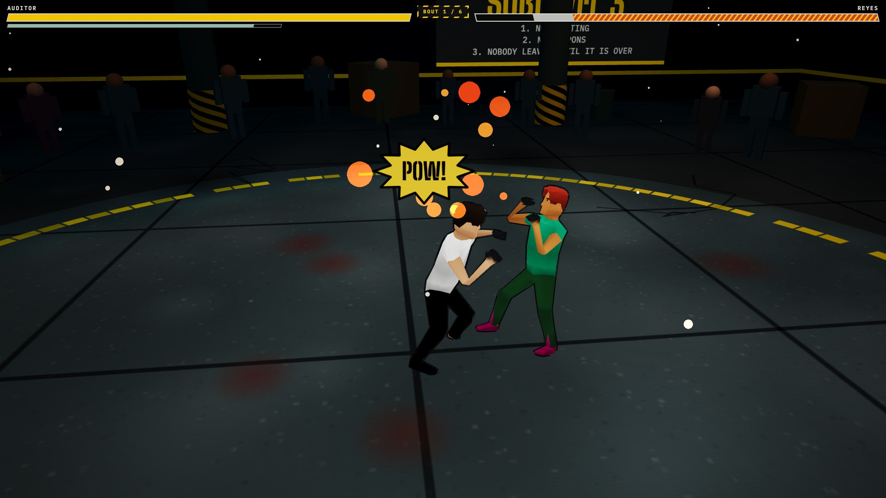

# Sublevel Three

Browser fighting game. One HTML file, no account, no build step to play.

**Play:** https://carlok.github.io/red-ink/

## About

You audit pallet counts on the night shift at Halvorsen Freight. The totals always reconcile. Tonight Pike hands you a keycard and points at a door that is not on the floor plan.

Three bouts, on a taped circle in a warehouse. Reyes teaches, Dag punishes a miss, Pike repeats your last three punches. Keyboard, standard gamepad, and touch. Drop a `.glb` on the title card to fight as an imported avatar. The engine is a tree-shaken Babylon.js build. The game runs from the files on disk. Google Fonts load when you are online and fall back to system fonts when you are not.

## Topics

`fighting-game` `babylonjs` `webgl` `browser-game` `html5` `gamepad` `touch` `apache-2.0`

## Run locally

Open `index.html` in Chrome, Firefox, or Edge.

License: Apache-2.0 (`LICENSE`, `NOTICE`). The sounds are CC0 (`audio/CC0.txt`).

## Quality assurance

- `npm run regression` — headless Chrome checks (bouts 1–6, hub/dock, input, offline `file://`).
- `npm run balance` — seeded bot win rates for all six foes.
- `npm run offline-zip` — writes `dist/sublevel-three-offline.zip` for offline play.
- `npm run qa:a11y` — axe on the title card (+ Lighthouse when the host finishes in time).
- Viewports: `docs/DEVICE-MATRIX.md`.

Engine: `lib/babylon.js` is a tree-shaken build of `@babylonjs/core` 9.30.0 plus the glTF 2.0 loader. License text: `lib/babylon.Apache-2.0.txt`. Regenerate the bundle with `npm install && npm run build:engine`.

## Controls

| | |
| --- | --- |
| Move | W A S D or arrow keys |
| Jab | J, also Z |
| Heavy | K, also X |
| Block (hold) | L, also C or Shift |
| Dodge | Space, also V |
| Pause | Esc, or Start on a pad |

On the title card, click Jab, Heavy, Block, or Dodge and press a new key. Movement stays on WASD. The Z, X, C, V, and Shift aliases stay.

Gamepad, standard mapping: left stick or d-pad moves, X jabs, Y is heavy, A dodges. LT and RT block once the trigger is past halfway. LB, RB, and B block as buttons.

The title card has Easy, Normal, and Hard. Normal uses the bout table as tuned. Easy and Hard scale that table: health, speed, damage, guard rate, and reaction. The same card has a rumble slider. 0 is off. Key bindings, difficulty, rumble, the Hits and Music sliders, mute, and Less motion are saved in local storage when the browser allows it.

Reyes shows a mark before a jab. Dag answers a miss with a marked heavy. Pike repeats your last three attacks. The card after a bout lists hits, blocks, dodges, and seconds in the corner.

A hit turns the head toward that side. Knockdowns fall back, crumple, or drop sideways. Bruises and sweat build during the bout.

The overhead light is cold. The hanging bulbs are sodium orange. The crowd around the ring is built from shoulders, arms, and legs, and they sway while they stand.

Hits, blocks, and the K.O. are samples. A room tone and three music loops sit under them, and the music ducks when a hit lands.

Esc pauses a bout. The first fight shows a 12-second control strip.

Touch: move stick on the left, Jab in the bottom-right of the button cluster. The view does not scroll or zoom.

Drop a `.glb` on the title screen to replace the auditor. Fighters are otherwise built in code (`makeFighter`). Tuning constants are at the top of the script: `ATK`, `LOOKS`, `BOUTS`, `CAM`.

Fighters are skinned low-poly people (CC0, see Credits) animated by the fight state: each clip is scrubbed by sim time, so hitstop, pause, and the fixed step stay exact. Every opponent gets a random look each session: skin, hair, shirt, pants, and shoes are drawn so that neighbouring colours always differ clearly, and no two people in a session share a skin, hair, shirt, pants or shoe colour. The height and build stay near the opponent's own, and a soft gradient on skin, hair, clothes and shoes keeps arms and faces from reading flat. Fighters have a dark outline, a rim of the place's key light on their edges, hand wraps, creases at the joints, and a face that flushes and bruises as they take hits. Add `?skin=0` to the address to play with the original procedural fighters, or `?skinseed=7` to repeat a set of looks. If the model cannot be loaded the game falls back to the procedural fighters by itself.

Each bout is in its own part of the sublevel. It is the same room, but the floor, the colour of the fixtures, the light, the fog, the dust, the two side signs and a few props change: a wet concrete sump, a steel dock deck with containers, a survey-sheet floor, a frosted cold store with icicles, a gatehouse with pavers and red-and-white bollards, and a black-glass floor with a lit grid for the last bout. The yellow edge of the ring stays the same everywhere.

The page opens on a silent splash with a Play button: nothing makes a sound until you press it, and Quit (from the pause menu or the title card) returns to it with the sound stopped. Before each bout a dossier card shows the next opponent standing in the place he will fight in, the camera walking all the way round him, with his name, his six metrics, his style, a strength, a weakness and a tip. The music is played live by a small sequencer (no audio files): a tempo, root and scale for each place, with a bass, drums, a motif and a pad that come in only at moments (a card, a fighter under 40% health, a roar from the crowd, a knockout). Fourteen of the spectators are the fighters' model with a random look, styled by the place (hi-vis at the dock, parkas in the cold store).

The camera is sized from the frame: a fighter fills about a third of the screen height at close range, and both stay in view during a chase or a knockback. On a phone held upright the width limits it: only about 5 m of floor fits across, so the fighters fill about 18% of the height. `CAM` holds the numbers.

The fight steps at a fixed 60 Hz and the view interpolates, so reaction times and hit windows run on the same clock on a 30, 60, or 144 Hz screen.

Quality steps down resolution, then shadow filtering, then shadows, when the frame rate stays under 44 for 1.8 seconds. The floor is half the starting resolution.

## Credits

The same list is in the game: Credits on the title card and in the pause menu.

- Game by Carlo Perassi, Apache-2.0.
- [Babylon.js](https://www.babylonjs.com) 9.30 (`lib/babylon.js` is a tree-shaken build), Apache-2.0.
- [Animated Human](https://opengameart.org/content/animated-human-low-poly) by [Quaternius](https://quaternius.com), CC0 1.0. Nothing requires attribution, but it deserves it. `assets/quaternius-human/` says how the files were converted and which clips (Guard, HitA, HitB, HitHeavy, TellJab) were added in Blender with `tools/blender/author-clips.py`.
- Big Shoulders Stencil Display (the Big Shoulders Project Authors), IBM Plex Mono and IBM Plex Sans Condensed (IBM), SIL Open Font License 1.1. They are served from `assets/fonts/` (Latin subset, licences and notes there), so the page makes no request to any other host and `file://` works offline.
- Sound generated for the game by `tools/make-audio.mjs`, CC0 (`audio/CC0.txt`).
